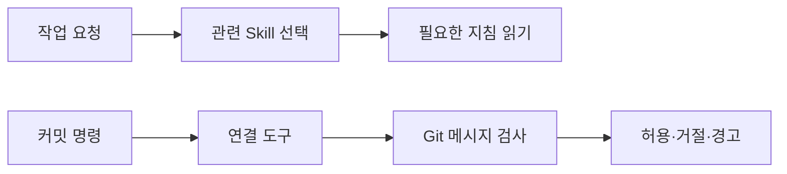

# REQ02 프로젝트 상세 페이지 명세

[REQ02-03~06·08](../../REQUIREMENTS/REQ02.md)을 구체화한다. 기존 `/projects/:slug` 경로 체계를 사용하되, 두 프로젝트의 읽기 화면은 공통 내비게이션 없이 별도 레이아웃으로 제공한다. 구현된 경로와 데이터 소유권은 [현재 아키텍처](../../architecture.md)에 기록한다.

## 공통 읽기 흐름

1. **첫 화면:** 프로젝트 이름, 한 문장 설명, 누구의 어떤 문제인지, 현재 구현 상태를 짧게 보여준다.
2. **문제와 선택:** 사용자의 상황을 평이한 말로 설명한 뒤 중요한 설계 판단 1~2개를 제시한다.
3. **만든 방식:** 개인 프로젝트에서 작성자가 내린 설계 판단과 AI를 활용한 방식을 구분한다. Maple Insight의 경험이 Codex Workspace로 이어진 이유를 두 페이지에서 서로 연결한다.
4. **그림으로 이해:** 구성요소 지도와 대표 작업 흐름을 별개로 보여준다. 구성요소 지도는 “누가 어떤 일을 맡는가”, 흐름은 “사용자가 한 행동 뒤 무슨 일이 일어나는가”를 답한다.
5. **실제 결과:** 구현·검증된 내용과 진행 중·계획 중인 내용을 시각적으로 구분한다. 각 주장 옆에 분석 문서, 코드, 검증 기록을 연결한다.
6. **더 깊이:** 개발자를 위한 상세 근거 링크를 제공한다. 사용자가 원하지 않으면 전문 용어 설명을 모두 읽지 않아도 핵심을 이해할 수 있어야 한다.

데스크톱에서는 `요약 → 문제/판단 → 만든 방식 → 구성요소 지도 → 작업 흐름 → 결과와 근거`를 세로로 읽는다. 공통 사이트 내비게이션과 푸터 대신 작은 프로젝트 목록 복귀 링크를 두어 본문 폭을 확보한다. 데스크톱은 오른쪽 스티키 목차, 모바일은 본문 위 접이식 목차를 제공한다. 목차를 누르면 해당 절로 스크롤하고 초점을 이동한다. 첫 화면에 기술 스택만 길게 나열하지 않는다.

## 도식과 상호작용

- 도식의 노드는 “화면”, “데이터를 가져오는 서버”, “원본 보관함”처럼 역할을 먼저 쓰고, 필요할 때 기술명을 보조로 붙인다.
- 화살표에는 무엇이 이동하는지 짧게 적는다. 완료된 흐름은 실선, 아직 계획인 흐름은 점선과 `계획` 문구로 구분한다. 색상만으로 상태를 구분하지 않는다.
- 큰 그림은 모바일에서 한 줄씩 읽는 단계형 배치로 바뀌며, 축소된 도식을 억지로 가로 스크롤하게 하지 않는다.
- 각 도식에는 제목, 1~2문장 요약, 그림과 같은 순서의 텍스트 설명을 둔다. 장식용 모션보다 읽기·키보드 탐색·대비를 우선한다.
- 기술 용어를 눌러 짧은 설명을 볼 수 있다면 키보드와 터치에서도 열리고 닫혀야 한다. 구현이 복잡해지면 항상 보이는 짧은 설명을 사용한다.

## Maple Insight 페이지

| 블록                        | 비개발자에게 전달할 말                                                                                                                                                                        | 근거                                                                                                              |
| --------------------------- | --------------------------------------------------------------------------------------------------------------------------------------------------------------------------------------------- | ----------------------------------------------------------------------------------------------------------------- |
| 프로젝트 소개               | 캐릭터 정보를 찾고, 게임 데이터의 변경을 안전하게 살펴보는 도구                                                                                                                               | [프로젝트와 아키텍처](../../portfolio/maple-insight/architecture.md)                                              |
| 구성요소 지도               | 조회 화면·서버·외부 API와 관리 화면·원본 파일·DB의 책임은 다르다                                                                                                                              | [앱별 분석](../../portfolio/maple-insight/applications.md)                                                        |
| 공통 타입의 역할            | 프런트엔드·백엔드·DB·Electron이 서로 같은 데이터 형식을 이해하며, 외부 API·내부 계약·화면 전용 타입은 분리한다                                                                                | [패키지 분석](../../portfolio/maple-insight/packages.md)                                                          |
| 조회 흐름                   | 닉네임 입력 → 캐릭터 식별 → 외부 정보 조회 → 화면 표시. 현재 화면은 이미지·장비 중심이다                                                                                                      | [핵심 흐름](../../portfolio/maple-insight/flows.md)                                                               |
| 데이터 관리 흐름            | 원본 가져오기 → 검증 → 버전 비교는 완료 기록이 있고, 편집은 진행 중이며 승인 반영은 계획이다                                                                                                  | [구현 상태](../../portfolio/maple-insight/status-and-gaps.md)                                                     |
| Electron 분리와 아이콘 경로 | 웹 관리자는 사이트 운영을 맡기려는 구상이고, Electron은 CSV 변환·검증·비교와 별도의 C# 스킬 아이콘 추출·표시를 담당한다. PNG 생성과 로컬 표시의 검증 범위, 전체 자동화의 남은 범위를 구분한다 | [앱별 분석](../../portfolio/maple-insight/applications.md), [데이터 흐름](../../portfolio/maple-insight/flows.md) |

공개 화면·스크린샷은 출처와 촬영 시점을 표시한다. 수집·시뮬레이션·자동 publish를 완성된 사용자 기능으로 묘사하지 않는다.

데이터 관리 흐름의 첫 도식 초안은 다음과 같다. `진행 중`과 `계획`은 화면에서도 같은 글자로 표시한다.

그림의 텍스트 설명: 원본을 보존하면서 가져온 데이터를 검증하고 이전 버전과 비교한다. 편집은 진행 중이며, 승인 후 DB 반영은 계획 단계다.

## Codex Workspace 페이지

| 블록           | 비개발자에게 전달할 말                                                                                       | 근거                                                                          |
| -------------- | ------------------------------------------------------------------------------------------------------------ | ----------------------------------------------------------------------------- |
| 프로젝트 소개  | 개발 작업에 필요한 지침과 검사를 한곳에서 관리하는 작업 공간                                                 | [개요](../../portfolio/codex-workspace/project-overview.md)                   |
| 시작 배경      | Maple Insight에서 앱별 책임과 규칙을 README·AGENTS만으로 찾기 어려워진 경험                                  | [Maple Insight 구성 가이드](../../portfolio/maple-insight/portfolio-brief.md) |
| 구성요소 지도  | 작업 요청을 보고 관련 지침을 찾는 Skill, 형식 오류를 검사하는 Hook, 아직 제안 단계인 문서를 나눈다           | [아키텍처](../../portfolio/codex-workspace/system-architecture.md)            |
| 지침 선택 흐름 | 작업 종류 파악 → 관련 Skill 선택 → 필요한 설명만 읽기. 선택은 에이전트가 지침을 따르는 과정이다              | [사례 1](../../portfolio/codex-workspace/engineering-case-studies.md)         |
| 커밋 검사 흐름 | 커밋 명령 → 연결 도구 → Git의 메시지 검사 → 허용·거절·경고. 실제 설치된 환경의 동작과 소스 테스트는 구분한다 | [사례 2와 한계](../../portfolio/codex-workspace/engineering-case-studies.md)  |

두 제어 방식의 차이를 보여줄 첫 도식 초안은 다음과 같다.

그림의 텍스트 설명: 작업 지침을 고르는 경로와 커밋 메시지 형식을 검사하는 경로는 별개다. 앞의 선택은 에이전트가 지침을 따르는 과정이고, 뒤의 검사는 Git Hook 소스에서 수행된다.

## 경로와 연결

- 계획 경로: `/projects/maple-insight`, `/projects/codex-workspace`. 기존 `HashRouter`에서 공개 URL은 각각 `https://jo4086.github.io/#/projects/...`가 된다.
- Projects 목록과 PDF에서 같은 상세 페이지로 이동한다. 상세 페이지에는 PDF로 돌아가거나 다른 프로젝트로 이동할 수 있는 명확한 링크를 둔다.
- 원본 GitHub 문서와 이 저장소의 사본 중 어떤 것이 최신 근거인지 표시한다. 링크가 공개 접근 가능한지 배포 후 확인한다.
